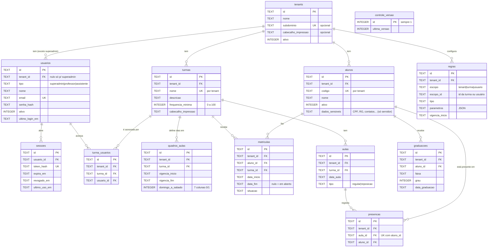

# Banco de dados — MER e dicionário de dados

Descreve o esquema do servidor (Cloudflare D1 / SQLite) criado por [`db/migrations/0001_inicial.sql`](../db/migrations/0001_inicial.sql).

> **Este documento acompanha as migrações.** Toda migração nova que mudar tabelas, colunas, chaves ou índices atualiza este arquivo no mesmo PR.

## Convenções

| Item | Regra |
|---|---|
| Identificadores (`id`) | `TEXT` com UUID v7 gerado no cliente. Exceção: aula regular usa UUID v5 de `turma_id` + `data_aula` |
| Timestamps (`*_at`, `*_em`) | `TEXT` ISO 8601 em UTC, ex.: `2026-11-12T13:45:00.000Z` |
| Datas de calendário (`data_*`, `vigencia_*`) | `TEXT` `AAAA-MM-DD`, sem fuso (dia local da academia) |
| Booleanos | `INTEGER` 0 ou 1 |
| Exclusão | lógica: `excluido = 1`; nada é apagado de verdade |
| Unicidade de negócio | vale só para registros com `excluido = 0` (índice parcial), salvo indicação |
| Isolamento de tenant | toda consulta da API filtra por `tenant_id` vindo do token |
| Sincronizada | tabela enviada ao banco local do app (drift) para a presença offline de reserva |

### Colunas padrão

Repetidas nas tabelas de negócio; no dicionário de cada tabela aparecem marcadas como *padrão*.

| Coluna | Tipo | Obrigatória | Padrão | Descrição |
|---|---|---|---|---|
| `created_at` | TEXT | sim | agora (UTC) | quando o registro foi criado |
| `updated_at` | TEXT | sim | agora (UTC) | última alteração; decide conflito (última edição vence) |
| `excluido` | INTEGER | sim | 0 | exclusão lógica (0 ou 1) |
| `server_version` | INTEGER | sim | 0 | **só em tabelas sincronizadas**: número crescente dado pela API a cada gravação; cursor do pull |
| `created_by` | TEXT | não | — | `usuarios.id` de quem criou |
| `updated_by` | TEXT | não | — | `usuarios.id` de quem alterou por último |

## MER (modelo entidade-relacionamento)



Notas do diagrama:
- Para não poluir, o diagrama mostra a ligação com `tenants` só nas entidades principais; **todas** as tabelas de negócio têm `tenant_id` → `tenants.id`.
- As colunas padrão (`created_at`, `updated_at`, `excluido`, `server_version`, `created_by`, `updated_by`) estão omitidas.
- `regras.escopo_id` aponta para uma turma ou um usuário conforme `escopo`; por isso não tem chave estrangeira.
- `controle_versao` não se relaciona com as outras: é o contador que gera o `server_version`.

## Visão geral das tabelas

| Tabela | Descrição | Sincronizada | Fase |
|---|---|---|---|
| [`tenants`](#tenants) | academia ou equipe | não | 1 |
| [`usuarios`](#usuarios) | pessoas que acessam o sistema | não | 1 |
| [`sessoes`](#sessoes) | sessões de login (refresh tokens) | não | 1 |
| [`turmas`](#turmas) | turmas da academia | sim | 1 |
| [`turma_usuarios`](#turma_usuarios) | quais usuários acessam quais turmas | sim | 1 |
| [`alunos`](#alunos) | cadastro de alunos | sim (parcial) | 1 |
| [`graduacoes`](#graduacoes) | histórico de faixas e graus | não | 1 |
| [`matriculas`](#matriculas) | aluno numa turma, com período | sim | 1 |
| [`quadros_aulas`](#quadros_aulas) | dias de aula da turma, com vigência | sim | 1 |
| [`aulas`](#aulas) | aulas lançadas (regulares e reposições) | sim | 1 |
| [`presencas`](#presencas) | quem esteve em cada aula | sim | 1 |
| [`regras`](#regras) | regras de cálculo configuráveis | não | 1 |
| [`controle_versao`](#controle_versao) | contador do cursor de sincronização | — | 1 |
| `mensalidades` | pagamentos mensais | — | 2 (migração futura) |

## Dicionário de dados

### tenants

Academia ou equipe. Cada tenant tem seus próprios dados, isolados dos outros. Só o `superadmin` cadastra. **Online.**

| Coluna | Tipo | Obrigatória | Padrão | Descrição / restrições |
|---|---|---|---|---|
| `id` | TEXT | sim | — | **PK**. UUID v7 |
| `nome` | TEXT | sim | — | nome da academia; não pode ser vazio |
| `subdominio` | TEXT | não | — | subdomínio próprio (futuro), ex.: `equipejuniao`; único sem diferenciar maiúsculas |
| `cabecalho_impressao` | TEXT | não | — | texto extra no cabeçalho dos relatórios impressos (ex.: nome do professor) |
| `ativo` | INTEGER | sim | 1 | 0 = tenant desativado |
| `created_at`, `updated_at`, `excluido`, `created_by`, `updated_by` | | | | *padrão* (sem `server_version`) |

Índices: `ux_tenants_subdominio` (único, `subdominio`, quando preenchido e não excluído).

### usuarios

Pessoas que acessam o sistema. O `tipo` define as permissões. **Online.**

| Coluna | Tipo | Obrigatória | Padrão | Descrição / restrições |
|---|---|---|---|---|
| `id` | TEXT | sim | — | **PK**. UUID v7 |
| `tenant_id` | TEXT | depende | — | **FK** → `tenants.id`. Nulo **se e somente se** `tipo = superadmin` |
| `tipo` | TEXT | sim | — | `superadmin` (administrador do sistema), `professor` ou `assistente` |
| `nome` | TEXT | sim | — | nome da pessoa; não pode ser vazio |
| `email` | TEXT | sim | — | login; único no sistema inteiro, sem diferenciar maiúsculas |
| `senha_hash` | TEXT | sim | — | hash da senha: `pbkdf2-sha256$<iterações>$<salt>$<hash>`; a senha nunca é gravada |
| `ativo` | INTEGER | sim | 1 | 0 = usuário bloqueado |
| `ultimo_login_em` | TEXT | não | — | timestamp do último login |
| `created_at`, `updated_at`, `excluido`, `created_by`, `updated_by` | | | | *padrão* (sem `server_version`) |

Índices: `ux_usuarios_email` (único, `email`, não excluídos), `ix_usuarios_tenant`.

### sessoes

Sessões de login. Cada uma corresponde a um refresh token. **Online.**

| Coluna | Tipo | Obrigatória | Padrão | Descrição / restrições |
|---|---|---|---|---|
| `id` | TEXT | sim | — | **PK**. UUID v7 |
| `usuario_id` | TEXT | sim | — | **FK** → `usuarios.id` |
| `token_hash` | TEXT | sim | — | hash do refresh token (o token em si nunca é gravado); único |
| `expira_em` | TEXT | sim | — | timestamp de expiração |
| `revogado_em` | TEXT | não | — | preenchido quando a sessão é encerrada (logout ou revogação do usuário) |
| `ultimo_uso_em` | TEXT | não | — | último uso do token para renovar o acesso |
| `created_at` | TEXT | sim | agora (UTC) | quando a sessão foi aberta |

Índices: único em `token_hash`, `ix_sessoes_usuario`.

### turmas

Turmas da academia. **Sincronizada.**

| Coluna | Tipo | Obrigatória | Padrão | Descrição / restrições |
|---|---|---|---|---|
| `id` | TEXT | sim | — | **PK**. UUID v7 |
| `tenant_id` | TEXT | sim | — | **FK** → `tenants.id` |
| `nome` | TEXT | sim | — | nome da turma; único por tenant, sem diferenciar maiúsculas |
| `descricao` | TEXT | não | — | descrição livre |
| `frequencia_minima` | INTEGER | não | — | % mínimo de frequência para graduação, de 0 a 100 |
| `cabecalho_impressao` | TEXT | não | — | texto extra no cabeçalho dos relatórios da turma |
| `created_at`, `updated_at`, `excluido`, `server_version`, `created_by`, `updated_by` | | | | *padrão* |

Índices: `ux_turmas_nome` (único, `tenant_id` + `nome`, não excluídas), `ix_turmas_sync` (`tenant_id`, `server_version`).

### turma_usuarios

Quais usuários acessam quais turmas (N:N). Só `professor` altera. **Sincronizada**, para o app saber as turmas do usuário.

| Coluna | Tipo | Obrigatória | Padrão | Descrição / restrições |
|---|---|---|---|---|
| `id` | TEXT | sim | — | **PK**. UUID v7 |
| `tenant_id` | TEXT | sim | — | **FK** → `tenants.id` |
| `turma_id` | TEXT | sim | — | **FK** → `turmas.id` |
| `usuario_id` | TEXT | sim | — | **FK** → `usuarios.id` |
| `created_at`, `updated_at`, `excluido`, `server_version`, `created_by`, `updated_by` | | | | *padrão* |

Índices: `ux_turma_usuarios` (único, `turma_id` + `usuario_id`, não excluídos), `ix_turma_usuarios_usuario`, `ix_turma_usuarios_sync`.

### alunos

Cadastro de alunos do tenant. **Sincronizada parcialmente**: só `id`, `codigo`, `nome`, `ativo` e as colunas padrão vão para o aparelho. As colunas marcadas como **sensível** ficam só no servidor (LGPD).

| Coluna | Tipo | Obrigatória | Padrão | Descrição / restrições |
|---|---|---|---|---|
| `id` | TEXT | sim | — | **PK**. UUID v7 |
| `tenant_id` | TEXT | sim | — | **FK** → `tenants.id` |
| `codigo` | TEXT | sim | — | código do aluno definido pela academia (ex.: `10A`); único por tenant, sem diferenciar maiúsculas |
| `nome` | TEXT | sim | — | nome completo |
| `ativo` | INTEGER | sim | 1 | 0 = aluno inativo |
| `data_nascimento` | TEXT | não | — | **sensível**. `AAAA-MM-DD` |
| `sexo` | TEXT | não | — | **sensível** |
| `cpf` | TEXT | não | — | **sensível** |
| `rg` | TEXT | não | — | **sensível** |
| `telefone` | TEXT | não | — | **sensível** |
| `email` | TEXT | não | — | **sensível** |
| `endereco` | TEXT | não | — | **sensível** |
| `nome_pai` | TEXT | não | — | **sensível** |
| `telefone_pai` | TEXT | não | — | **sensível** |
| `nome_mae` | TEXT | não | — | **sensível** |
| `telefone_mae` | TEXT | não | — | **sensível** |
| `observacoes` | TEXT | não | — | **sensível**. observações livres |
| `created_at`, `updated_at`, `excluido`, `server_version`, `created_by`, `updated_by` | | | | *padrão* |

Índices: `ux_alunos_codigo` (único, `tenant_id` + `codigo`, não excluídos), `ix_alunos_nome`, `ix_alunos_sync`.

### graduacoes

Histórico de faixas e graus de cada aluno. **Online.**

| Coluna | Tipo | Obrigatória | Padrão | Descrição / restrições |
|---|---|---|---|---|
| `id` | TEXT | sim | — | **PK**. UUID v7 |
| `tenant_id` | TEXT | sim | — | **FK** → `tenants.id` |
| `aluno_id` | TEXT | sim | — | **FK** → `alunos.id` |
| `faixa` | TEXT | sim | — | faixa concedida (ex.: branca, azul) |
| `grau` | INTEGER | sim | 0 | grau dentro da faixa (0 ou mais) |
| `data_graduacao` | TEXT | sim | — | `AAAA-MM-DD` |
| `observacoes` | TEXT | não | — | observações livres |
| `created_at`, `updated_at`, `excluido`, `created_by`, `updated_by` | | | | *padrão* (sem `server_version`) |

Índices: `ix_graduacoes_aluno` (`aluno_id`, `data_graduacao`).

### matriculas

Vínculo do aluno com uma turma, com período. A presença só pode ser marcada em aulas dentro desse período. **Sincronizada.**

| Coluna | Tipo | Obrigatória | Padrão | Descrição / restrições |
|---|---|---|---|---|
| `id` | TEXT | sim | — | **PK**. UUID v7 |
| `tenant_id` | TEXT | sim | — | **FK** → `tenants.id` |
| `aluno_id` | TEXT | sim | — | **FK** → `alunos.id` |
| `turma_id` | TEXT | sim | — | **FK** → `turmas.id` |
| `data_inicio` | TEXT | sim | — | início da matrícula, `AAAA-MM-DD` |
| `data_fim` | TEXT | não | — | fim da matrícula, `AAAA-MM-DD`; nulo = em aberto; não pode ser anterior a `data_inicio` |
| `situacao` | TEXT | sim | `matriculado` | `matriculado`, `remanejado` ou `encerrado` |
| `created_at`, `updated_at`, `excluido`, `server_version`, `created_by`, `updated_by` | | | | *padrão* |

Índices: `ix_matriculas_turma` (`turma_id`, `data_inicio`), `ix_matriculas_aluno`, `ix_matriculas_sync`.

### quadros_aulas

Dias da semana em que a turma tem aula, com período de vigência. Uma turma pode ter vários quadros em ordem cronológica. Aula regular só pode ser lançada em dia habilitado pelo quadro vigente. **Sincronizada.**

| Coluna | Tipo | Obrigatória | Padrão | Descrição / restrições |
|---|---|---|---|---|
| `id` | TEXT | sim | — | **PK**. UUID v7 |
| `tenant_id` | TEXT | sim | — | **FK** → `tenants.id` |
| `turma_id` | TEXT | sim | — | **FK** → `turmas.id` |
| `vigencia_inicio` | TEXT | sim | — | início da vigência, `AAAA-MM-DD` |
| `vigencia_fim` | TEXT | não | — | fim da vigência, `AAAA-MM-DD`; nulo = vigente sem prazo; não pode ser anterior ao início |
| `domingo` | INTEGER | sim | 0 | 1 = tem aula no domingo |
| `segunda` | INTEGER | sim | 0 | 1 = tem aula na segunda |
| `terca` | INTEGER | sim | 0 | 1 = tem aula na terça |
| `quarta` | INTEGER | sim | 0 | 1 = tem aula na quarta |
| `quinta` | INTEGER | sim | 0 | 1 = tem aula na quinta |
| `sexta` | INTEGER | sim | 0 | 1 = tem aula na sexta |
| `sabado` | INTEGER | sim | 0 | 1 = tem aula no sábado |
| `created_at`, `updated_at`, `excluido`, `server_version`, `created_by`, `updated_by` | | | | *padrão* |

Índices: `ix_quadros_aulas_turma` (`turma_id`, `vigencia_inicio`), `ix_quadros_aulas_sync`.

### aulas

Aulas lançadas. Uma aula só existe quando é lançada; dia sem aula lançada (ex.: feriado) não conta na frequência. **Sincronizada.**

| Coluna | Tipo | Obrigatória | Padrão | Descrição / restrições |
|---|---|---|---|---|
| `id` | TEXT | sim | — | **PK**. Aula regular: UUID v5 determinístico de `turma_id` + `data_aula`. Reposição: UUID v7 |
| `tenant_id` | TEXT | sim | — | **FK** → `tenants.id` |
| `turma_id` | TEXT | sim | — | **FK** → `turmas.id` |
| `data_aula` | TEXT | sim | — | dia da aula, `AAAA-MM-DD`; não pode ser futura (regra da API e do app) |
| `tipo` | TEXT | sim | `regular` | `regular` (dia do quadro) ou `reposicao` (aula extra, qualquer dia) |
| `created_at`, `updated_at`, `excluido`, `server_version`, `created_by`, `updated_by` | | | | *padrão* |

Índices: `ux_aulas_regular` (único, `turma_id` + `data_aula`, só `tipo = regular` e não excluídas), `ix_aulas_turma_data`, `ix_aulas_sync`.

### presencas

Quem esteve em cada aula. Registra só presenças; falta é calculada (aula lançada, dentro da matrícula, sem presença). **Sincronizada.**

| Coluna | Tipo | Obrigatória | Padrão | Descrição / restrições |
|---|---|---|---|---|
| `id` | TEXT | sim | — | **PK**. UUID v7 |
| `tenant_id` | TEXT | sim | — | **FK** → `tenants.id` |
| `aula_id` | TEXT | sim | — | **FK** → `aulas.id` |
| `aluno_id` | TEXT | sim | — | **FK** → `alunos.id`; o aluno precisa estar matriculado na turma na data da aula (regra da API e do app) |
| `created_at`, `updated_at`, `excluido`, `server_version`, `created_by`, `updated_by` | | | | *padrão*. Desmarcar = `excluido` 1; remarcar = `excluido` 0 na mesma linha |

Índices: único em (`aula_id`, `aluno_id`) **incluindo excluídas**, `ix_presencas_aluno`, `ix_presencas_sync`.

### regras

Regras de cálculo configuráveis: tipos pré-definidos com parâmetros em JSON. A regra de escopo `tenant` é o padrão; `turma` e `usuario` sobrescrevem. **Online.**

| Coluna | Tipo | Obrigatória | Padrão | Descrição / restrições |
|---|---|---|---|---|
| `id` | TEXT | sim | — | **PK**. UUID v7 |
| `tenant_id` | TEXT | sim | — | **FK** → `tenants.id` |
| `escopo` | TEXT | sim | — | `tenant`, `turma` ou `usuario` |
| `escopo_id` | TEXT | depende | — | id da turma ou do usuário; nulo **se e somente se** `escopo = tenant` |
| `tipo` | TEXT | sim | — | tipo da regra, ex.: `frequencia_minima_graduacao` |
| `parametros` | TEXT | sim | `{}` | JSON válido com os parâmetros da regra |
| `vigencia_inicio` | TEXT | sim | — | a partir de quando a regra vale, `AAAA-MM-DD` |
| `created_at`, `updated_at`, `excluido`, `created_by`, `updated_by` | | | | *padrão* (sem `server_version`) |

Índices: `ux_regras` (único, `tenant_id` + `escopo` + `escopo_id` + `tipo` + `vigencia_inicio`, não excluídas).

Exemplo de `parametros` para `frequencia_minima_graduacao` (o percentual fica em `turmas.frequencia_minima`):

```json
{
  "periodos": [["01-01", "06-30"], ["07-01", "12-31"]],
  "meses_graduacao": [6, 12],
  "conta_reposicao": true
}
```

### controle_versao

Contador global que gera o `server_version`. Tem sempre uma única linha. Na mesma transação de cada gravação sincronizada, a API incrementa `ultima_versao` e grava o novo valor no registro.

| Coluna | Tipo | Obrigatória | Padrão | Descrição / restrições |
|---|---|---|---|---|
| `id` | INTEGER | sim | — | **PK**. Sempre 1 |
| `ultima_versao` | INTEGER | sim | 0 | último `server_version` atribuído |
