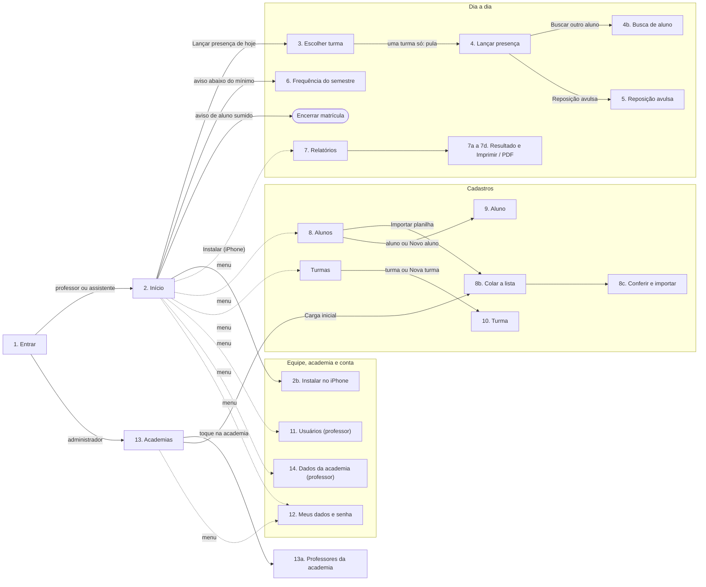
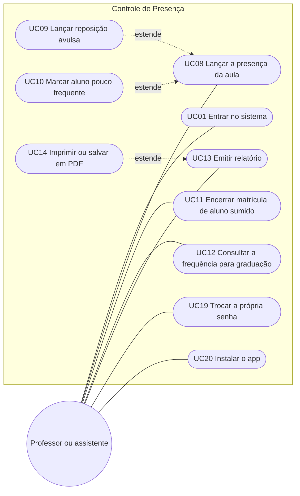
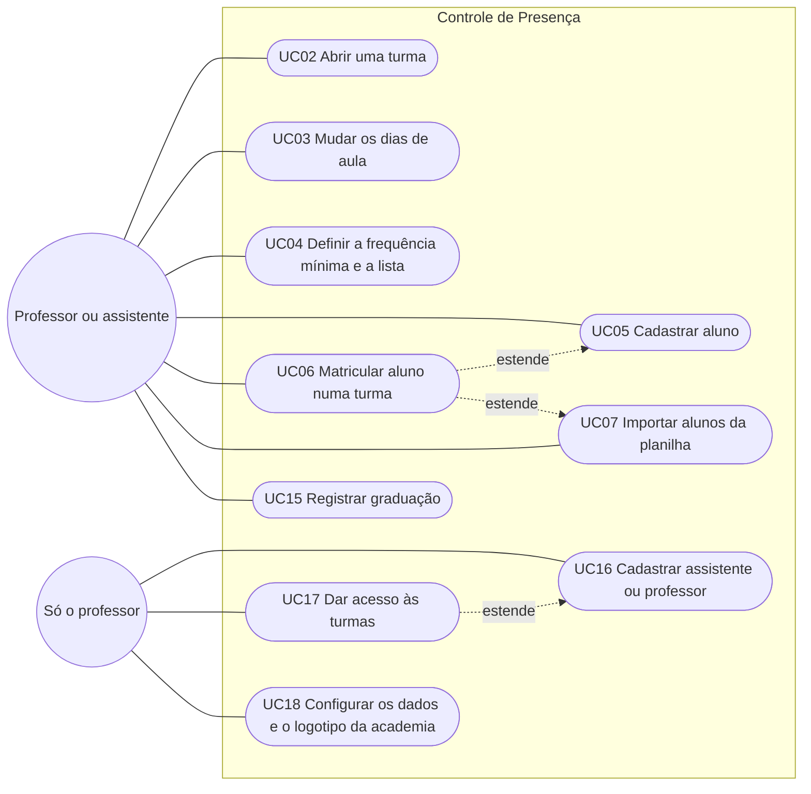
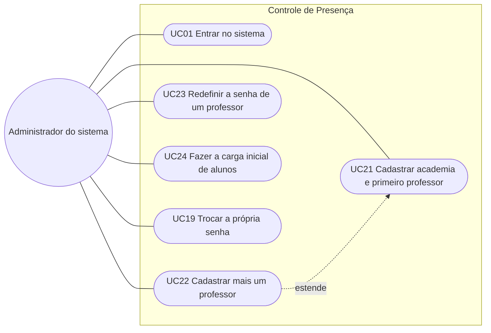

# Documentação funcional — fluxo de telas e casos de uso

Descreve **o que cada pessoa faz no sistema e por quais telas passa**, do ponto de vista de quem usa. Complementa a documentação técnica:

| Documento | O que tem |
|---|---|
| **Este arquivo** | atores, mapa de telas, diagramas de caso de uso e a lista dos casos de uso |
| [`casos-de-uso.md`](casos-de-uso.md) | cada caso de uso detalhado: objetivo, pré-condições, passo a passo, variações, regras e entidades |
| [`entidades-por-tela.md`](entidades-por-tela.md) | dicionário das entidades: o que são, como se comportam, como se relacionam e o que cada tela lê ou grava |
| [`../manuais/`](../manuais/README.md) | tutoriais para o professor, por objetivo ("quero matricular um aluno novo") |
| [`../telas/README.md`](../telas/README.md) | wireframes aprovados de cada tela |
| [`../banco-de-dados.md`](../banco-de-dados.md) | MER e dicionário de dados do servidor (colunas, tipos, índices) |

> Vale para a **Fase 1 (presença)**, publicada em `controlepresenca.tghservices.com.br`. Mensalidades (Fase 2) entram aqui quando a fase começar.

## Atores

| Ator | Quem é | O que pode fazer |
|---|---|---|
| **Administrador do sistema** (`superadmin`) | a TghServices; fica fora das academias | cadastrar academias e o primeiro professor de cada uma, cadastrar mais professores, redefinir a senha de um professor, fazer a carga inicial de alunos |
| **Professor** (`professor`) | dono ou responsável pela academia | tudo dentro da academia: alunos, turmas, quadro de aulas, regras, presença, relatórios, usuários e acesso às turmas, dados e logotipo da academia |
| **Assistente** (`assistente`) | quem lança a presença na aula, na prática | lançar presença, cadastrar alunos e turmas, matricular, ver relatórios; **não** cadastra usuários nem muda os dados da academia, e só vê as turmas a que tem acesso |

Todos entram com e-mail e senha criados por outra pessoa (não existe autocadastro) e podem trocar a própria senha em **Meus dados e senha**.

## Mapa de telas

Cada caixa é uma tela; o número é o do wireframe em [`../telas/README.md`](../telas/README.md). As setas mostram como se chega de uma tela à outra.

- **Celular:** o menu fica no botão ☰ do topo; cada tela abre por cima da anterior e o voltar retorna.
- **Desktop (a partir de ~1000 px):** o menu fica fixo na lateral. Lançar presença vira a grade da semana (D2), Alunos mostra lista e cadastro lado a lado (D3) e Relatórios mostra o resultado na mesma tela (D5, D6).
- **Sem internet:** Início, Lançar presença, Relatórios e Frequência do semestre funcionam com os dados do aparelho. As outras telas precisam de conexão (o servidor confere na hora).

## Diagramas de caso de uso

O GitHub não tem um diagrama de caso de uso próprio; os diagramas abaixo usam a mesma ideia: o ator à esquerda, os casos de uso (elipses) dentro do sistema e uma linha ligando quem faz o quê. A seta tracejada **estende** marca um caso de uso que acontece às vezes, a partir de outro.

### Dia a dia (professor ou assistente)

### Cadastros

> Quem altera **quem acessa cada turma** (UC17), os **usuários** (UC16) e os **dados da academia** (UC18) é só o professor. A assistente cadastra turmas e alunos, mas só enxerga as turmas a que o professor lhe deu acesso.

### Administrador do sistema

## Casos de uso

Detalhes de cada um em [`casos-de-uso.md`](casos-de-uso.md); o tutorial correspondente para o professor fica em [`../manuais/`](../manuais/README.md).

| Código | Caso de uso | Ator | Telas | Funciona offline |
|---|---|---|---|---|
| [UC01](casos-de-uso.md#uc01--entrar-no-sistema) | Entrar no sistema | todos | 1, 2 ou 13 | não (o primeiro acesso precisa de internet) |
| [UC02](casos-de-uso.md#uc02--abrir-uma-turma) | Abrir uma turma | professor, assistente | Turmas, 10 | não |
| [UC03](casos-de-uso.md#uc03--mudar-os-dias-de-aula-da-turma) | Mudar os dias de aula | professor, assistente | 10 | não |
| [UC04](casos-de-uso.md#uc04--definir-a-frequência-mínima-e-a-lista-do-lançamento) | Definir a frequência mínima e a lista | professor, assistente | 10 | não |
| [UC05](casos-de-uso.md#uc05--cadastrar-aluno) | Cadastrar aluno | professor, assistente | 8, 9 | não |
| [UC06](casos-de-uso.md#uc06--matricular-aluno-numa-turma) | Matricular aluno numa turma | professor, assistente | 9 | não |
| [UC07](casos-de-uso.md#uc07--importar-alunos-da-planilha) | Importar alunos da planilha | professor, assistente | 8, 8b, 8c | não |
| [UC08](casos-de-uso.md#uc08--lançar-a-presença-da-aula) | Lançar a presença da aula | professor, assistente | 2, 3, 4 (D2) | **sim** |
| [UC09](casos-de-uso.md#uc09--lançar-reposição-avulsa) | Lançar reposição avulsa | professor, assistente | 4, 5 | **sim** |
| [UC10](casos-de-uso.md#uc10--marcar-aluno-pouco-frequente) | Marcar aluno pouco frequente | professor, assistente | 4, 4b | **sim** |
| [UC11](casos-de-uso.md#uc11--encerrar-a-matrícula-de-aluno-sumido) | Encerrar matrícula de aluno sumido | professor, assistente | 2 ou 9 | não |
| [UC12](casos-de-uso.md#uc12--consultar-a-frequência-para-graduação) | Consultar a frequência para graduação | professor, assistente | 2, 6 ou 7 | **sim** |
| [UC13](casos-de-uso.md#uc13--emitir-relatório) | Emitir relatório | professor, assistente | 7, 7a a 7d (D5, D6) | **sim** |
| [UC14](casos-de-uso.md#uc14--imprimir-ou-salvar-em-pdf) | Imprimir ou salvar em PDF | professor, assistente | 7, P1 | **sim** |
| [UC15](casos-de-uso.md#uc15--registrar-graduação) | Registrar graduação | professor, assistente | 9 | não |
| [UC16](casos-de-uso.md#uc16--cadastrar-assistente-ou-professor) | Cadastrar assistente ou professor | professor | 11 | não |
| [UC17](casos-de-uso.md#uc17--dar-acesso-às-turmas) | Dar acesso às turmas | professor | 10 ou 11 | não |
| [UC18](casos-de-uso.md#uc18--configurar-os-dados-e-o-logotipo-da-academia) | Configurar os dados e o logotipo da academia | professor | 14 | não |
| [UC19](casos-de-uso.md#uc19--trocar-a-própria-senha) | Trocar a própria senha | todos | 12 | não |
| [UC20](casos-de-uso.md#uc20--instalar-o-app) | Instalar o app | professor, assistente | 2, 2b | — |
| [UC21](casos-de-uso.md#uc21--cadastrar-academia-e-primeiro-professor) | Cadastrar academia e primeiro professor | administrador | 13 | não |
| [UC22](casos-de-uso.md#uc22--cadastrar-mais-um-professor) | Cadastrar mais um professor | administrador | 13, 13a | não |
| [UC23](casos-de-uso.md#uc23--redefinir-a-senha-de-um-professor) | Redefinir a senha de um professor | administrador | 13a | não |
| [UC24](casos-de-uso.md#uc24--fazer-a-carga-inicial-de-alunos) | Fazer a carga inicial de alunos | administrador | 13, 8b, 8c | não |

## Fluxo de ponta a ponta: do cadastro ao relatório

A ordem em que uma academia nova costuma começar a usar o sistema:

```mermaid
flowchart LR
    a["UC21 Administrador cadastra a academia e o professor"] --> b["UC01 Professor entra e troca a senha (UC19)"]
    b --> c["UC18 Dados e logotipo da academia"]
    c --> d["UC02 Abre as turmas com os dias de aula"]
    d --> e["UC07 Importa os alunos da planilha, já matriculados"]
    e --> f["UC16 e UC17 Cadastra as assistentes e dá acesso às turmas"]
    f --> g["UC08 Assistentes lançam a presença em cada aula"]
    g --> h["UC13 Relatórios e UC12 frequência para graduação"]
```

