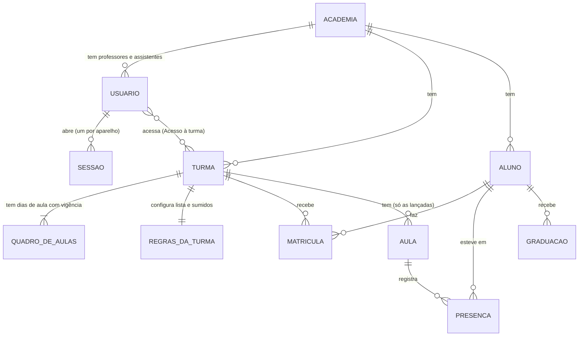
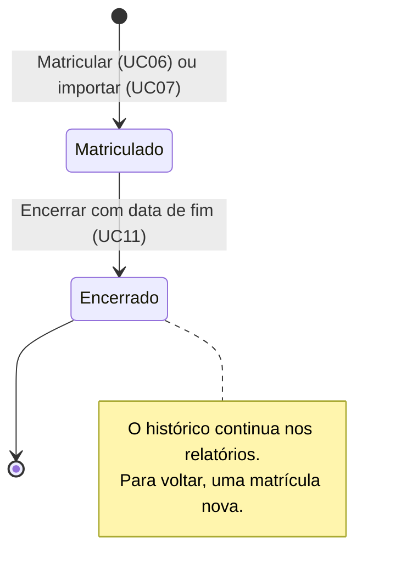

# Dicionário de entidades por tela

Explica **as coisas que o sistema guarda e calcula**, em linguagem de quem usa: o que cada uma representa, como se comporta (quando nasce, muda e termina) e como se relaciona com as outras. No fim, a matriz e o detalhe **tela a tela**.

- Colunas, tipos e índices de cada tabela: [`../banco-de-dados.md`](../banco-de-dados.md).
- Casos de uso citados (UC01 a UC24): [`casos-de-uso.md`](casos-de-uso.md).

## Visão geral

Leitura: uma **academia** tem usuários, turmas e alunos. O **aluno** entra numa **turma** por uma **matrícula**, com data de início e, quando sai, data de fim. A turma tem **quadros de aulas**, que dizem os dias da semana e a partir de quando valem. Cada **aula** lançada guarda as **presenças** de quem veio. A **falta** não é guardada: é calculada.

## Entidades guardadas

### Academia
- **O que é:** a academia ou equipe (o "tenant"). Um professor autônomo é uma academia com um usuário só.
- **Dados:** nome, nome curto (até 15 letras, embaixo do ícone do app instalado), cabeçalho de impressão, logotipo e os ícones de 192 e 512 px gerados dele, ativa.
- **Comportamento:** criada pelo administrador do sistema junto com o primeiro professor (UC21). O professor muda nome, nome curto, cabeçalho e logotipo (UC18). Desativada pelo administrador, todos os usuários dela perdem o acesso na hora.
- **Relações:** dona de todos os outros dados; uma academia nunca vê os dados de outra (o servidor filtra pela academia de quem está logado).
- **Onde fica:** só no servidor; o aparelho guarda o nome, o nome curto, o cabeçalho e o ícone para mostrar offline.

### Usuário
- **O que é:** uma pessoa com login: administrador do sistema, professor ou assistente.
- **Dados:** nome, e-mail (único no sistema inteiro), tipo, ativo, senha (guardada só como hash).
- **Comportamento:** criado por outra pessoa (UC16, UC21, UC22), nunca por autocadastro. Pode trocar a própria senha (UC19) ou ter a senha redefinida (UC16, UC23). Desativado, perde o acesso na hora e o app apaga os dados do aparelho dele.
- **Relações:** pertence a uma academia (menos o administrador do sistema); acessa N turmas pelo **Acesso à turma**; aparece como autor de cada lançamento (`created_by`).

### Sessão
- **O que é:** o login aberto num aparelho.
- **Comportamento:** nasce ao entrar (UC01), dura 30 dias e é renovada a cada uso; termina ao sair, ao trocar a senha (nos outros aparelhos), ao ter a senha redefinida ou o usuário desativado.
- **Relações:** de um usuário. Junto com a sessão, um cookie diz ao navegador qual é a academia, só para montar o ícone do app instalado.

### Turma
- **O que é:** um grupo de aulas com os mesmos dias e alunos (ex.: "Adulto", "Kids").
- **Dados:** nome (único na academia), descrição, **frequência mínima (%)** para graduação, cabeçalho de impressão.
- **Comportamento:** criada por professor ou assistente (UC02); quem cria passa a acessá-la. Editada na tela 10.
- **Relações:** tem quadros de aulas, regras, matrículas, aulas e acessos.
- **Onde fica:** servidor e aparelho (para lançar offline).

### Acesso à turma
- **O que é:** a ligação "esta pessoa vê e lança esta turma" (N:N entre usuário e turma).
- **Comportamento:** só o professor dá ou tira (UC17). Tirar faz a turma sumir do aparelho da pessoa na próxima sincronização.
- **Relações:** um usuário e uma turma.

### Quadro de aulas
- **O que é:** os dias da semana em que a turma tem aula, a partir de uma data.
- **Dados:** vigência (início e, se houver, fim) e, para cada dia, *sem aula*, *regular* ou *reposição*.
- **Comportamento:** o primeiro nasce com a turma. Mudar os dias cria um **quadro novo** a partir de uma data (UC03); o anterior continua valendo para as datas antes dela. Em cada dia, o sistema usa o quadro vigente naquela data.
- **Relações:** da turma; decide quais dias aparecem no lançamento e se a aula do dia é regular ou de reposição fixa.

### Regras da turma
- **O que é:** os ajustes que fazem o sistema se encaixar no jeito do professor.
- **Dados:** **lista do lançamento** (frequentes: ao menos X% das últimas N aulas; padrão 30% e 8) e **sumidos** (avisar após N semanas sem vir; padrão 4).
- **Comportamento:** editadas na tela 10 (UC04); valem a partir de quando são salvas.
- **Relações:** da turma; usadas pelo lançamento (quem aparece direto) e pelo Início (aviso de sumidos).

### Aluno
- **O que é:** a pessoa que treina na academia.
- **Dados:** código (único na academia, ex.: `10A`), nome, ativo e os **dados pessoais** (nascimento, sexo, CPF, RG, telefone, e-mail, endereço, pais e observações).
- **Comportamento:** cadastrado à mão (UC05) ou importado da planilha (UC07, UC24). Inativar tira das listas de ativos sem apagar nada.
- **Relações:** faz matrículas, tem presenças e graduações.
- **Onde fica:** **os dados pessoais ficam só no servidor** (LGPD; muitos alunos são menores). O aparelho guarda só código e nome.

### Matrícula
- **O que é:** o aluno numa turma, de uma data até outra.
- **Dados:** turma, aluno, início, fim (vazio = em aberto) e situação.
- **Estados:**

- **Comportamento:** um aluno pode estar em várias turmas, com uma matrícula em cada, mas não em duas matrículas sobrepostas na mesma turma. A presença só é aceita entre o início e o fim.
- **Relações:** um aluno e uma turma; delimita quais aulas contam para o aluno (presença, falta e frequência).

### Aula
- **O que é:** um dia de aula **lançado** de uma turma.
- **Dados:** turma, data, tipo (**regular** ou **reposição**).
- **Comportamento:**
  - nasce sozinha na **primeira marcação** de presença do dia (UC08); não existe "abrir aula";
  - dia sem nenhuma marcação (feriado, aula cancelada) não vira aula e não gera falta;
  - aula regular: uma por turma e dia, num dia regular do quadro;
  - reposição fixa: num dia de reposição do quadro;
  - reposição avulsa: qualquer dia não futuro, criada pela tela 5 (UC09); pode haver mais de uma no mesmo dia;
  - nunca no futuro.
- **Relações:** da turma; tem presenças.

### Presença
- **O que é:** "este aluno esteve nesta aula".
- **Comportamento:** marcar cria; desmarcar desativa (nada é apagado de verdade, para dois aparelhos não se atrapalharem); marcar de novo reativa. Gravada primeiro no aparelho e enviada em seguida; sem internet, espera na fila de envio. Se dois aparelhos mexem no mesmo aluno, vale a última alteração.
- **Relações:** uma aula e um aluno, que precisa estar matriculado na turma na data.

### Graduação
- **O que é:** a faixa e o grau que o aluno recebeu numa data.
- **Comportamento:** registrada no cadastro do aluno (UC15); excluída com toque longo. A mais recente é a **faixa atual** (mostrada na lista de alunos do desktop).
- **Relações:** do aluno. Só no servidor.

## Informações calculadas (nunca gravadas)

| Informação | Como é calculada | Onde aparece |
|---|---|---|
| **Falta** | aula lançada, dentro da matrícula do aluno, sem presença dele | relatórios (ponto ou "faltou") |
| **Frequência para graduação** | (presenças em aulas regulares + presenças em reposições) ÷ aulas regulares lançadas no semestre (jan–jun ou jul–dez), só dentro da matrícula; limite de 100% | tela 6, relatório "Frequência para graduação", aviso do Início, mensal |
| **Abaixo do mínimo** | frequência do semestre menor que a frequência mínima da turma | vermelho nos relatórios e na tela 6; aviso do Início |
| **Frequente / pouco frequente** | presença em pelo menos X% das últimas N aulas regulares (regras da turma); matrícula com menos de N aulas é "novo" e sempre aparece | lista do lançamento (tela 4) |
| **Aluno sumido** | matriculado e sem presença há mais semanas que o configurado | aviso e lista do Início |
| **Relatórios** | semanal, mensal, anual, por aluno e graduação, montados na hora a partir das aulas e presenças | tela 7 e página impressa |
| **Status de envio** | quantas marcações ainda estão na fila do aparelho | "Tudo enviado" / "N aguardando envio" |

## Matriz tela × entidade

**C** cria · **L** lê · **A** altera · **E** encerra ou exclui · — não usa. "Offline" indica a tela que funciona sem internet.

| Tela | Academia | Usuário | Turma | Acesso | Quadro | Regras | Aluno | Matrícula | Aula | Presença | Graduação |
|---|---|---|---|---|---|---|---|---|---|---|---|
| 1 Entrar | — | L | — | L | — | — | — | — | — | — | — |
| 2 Início (offline) | L | L | L | — | L | L | L | L, E | L | L | — |
| 2b Instalar no iPhone | L | — | — | — | — | — | — | — | — | — | — |
| 3 Escolher turma (offline) | — | — | L | L | — | — | — | — | — | — | — |
| 4 Lançar presença (offline) | — | — | L | — | L | L | L | L | C, L | C, L, A | — |
| 4b Busca de aluno (offline) | — | — | — | — | — | — | L | L | C | C, A | — |
| 5 Reposição avulsa (offline) | — | — | L | — | — | — | L | L | C | C | — |
| 6 Frequência do semestre (offline) | — | — | L | — | L | — | L | L | L | L | — |
| 7 Relatórios (offline) | L | L | L | — | — | — | L | L | L | L | — |
| 8 Alunos | — | — | — | — | — | — | L | — | — | — | L |
| 8b / 8c Importar alunos | — | — | L | — | — | — | C, L | C | — | — | — |
| 9 Aluno | — | — | L | — | — | — | C, L, A | C, L, E | — | — | C, L, E |
| Turmas | — | — | L | — | — | — | — | L | — | — | — |
| 10 Turma | — | L | C, L, A | C, E | C, L | L, A | — | — | — | — | — |
| 11 Usuários | — | C, L, A | L | C, E | — | — | — | — | — | — | — |
| 12 Meus dados e senha | L | L, A | — | — | — | — | — | — | — | — | — |
| 13 Academias | C, L | C | — | — | — | — | — | — | — | — | — |
| 13a Professores da academia | L | C, L, A | — | — | — | — | — | — | — | — | — |
| 14 Dados da academia | L, A | — | — | — | — | — | — | — | — | — | — |

## Tela a tela

### 1. Entrar
- **Lê:** Usuário (confere e-mail e senha). **Cria:** Sessão.
- **Comportamento:** depois do login, baixa para o aparelho as turmas permitidas e o que for preciso para lançar offline.

### 2. Início
- **Lê:** Academia (nome, logotipo), as turmas do usuário, o resumo do ano (aulas, frequência média, alunos ativos), quem está **abaixo do mínimo** e os **sumidos**.
- **Encerra:** Matrícula, pelo botão "Encerrar" de um aluno sumido (UC11; precisa de internet).
- **Comportamento:** o convite para instalar o app só aparece depois do login (UC20).

### 2b. Instalar no iPhone
- **Lê:** nome curto e ícone da academia, que o app informa ao iPhone.

### 3. Escolher turma
- **Lê:** as turmas a que o usuário tem acesso. Com uma só, a tela é pulada.

### 4. Lançar presença (D2 no desktop)
- **Lê:** quadro vigente (quais dias aparecem e o tipo de cada um), regras da lista, alunos com matrícula no dia, presenças já marcadas (inclusive de outros aparelhos).
- **Cria:** Aula, na primeira marcação do dia. **Cria / altera:** Presença (marcar e desmarcar).
- **Comportamento:** grava no aparelho e envia em seguida; mostra o status de envio; bloqueia dia futuro e dias fora da matrícula.

### 4b. Busca de aluno pouco frequente
- **Lê:** alunos matriculados que não estão na lista principal. **Cria / altera:** Presença.

### 5. Reposição avulsa
- **Cria:** Aula de reposição no dia escolhido; depois, Presenças nela.

### 6. Frequência do semestre
- **Lê:** aulas e presenças do semestre, matrículas e a frequência mínima da turma; calcula a frequência de cada aluno.

### 7. Relatórios (7a a 7d; D5 e D6 no desktop)
- **Lê:** aulas, presenças, matrículas, alunos, a turma e a academia (para o cabeçalho da impressão).
- **Comportamento:** calcula tudo na hora, no aparelho; a impressão abre numa aba nova (UC14).

### 8. Alunos (D3 no desktop)
- **Lê:** a lista de alunos com as turmas em que estão matriculados e, no desktop, a faixa atual (última graduação).

### 8b e 8c. Importar alunos
- **Lê:** as turmas (para escolher onde matricular). **Cria:** Alunos e, com turma escolhida, Matrículas a partir da data informada.
- **Comportamento:** primeiro confere (relatório de problemas), depois grava tudo de uma vez.

### 9. Aluno
- **Cria / altera:** Aluno (inclusive os dados pessoais, só online). **Cria / encerra:** Matrícula. **Cria / exclui:** Graduação.

### Turmas
- **Lê:** as turmas com os dias de aula e o número de alunos matriculados.

### 10. Turma
- **Cria / altera:** Turma (nome, frequência mínima, cabeçalho). **Cria:** Quadro de aulas (um novo a cada mudança de dias). **Altera:** Regras da turma. **Cria / encerra:** Acesso à turma (só professor).

### 11. Usuários (só professor)
- **Cria / altera:** Usuário (inclusive ativo e senha redefinida). **Cria / encerra:** Acesso à turma.

### 12. Meus dados e senha
- **Lê:** o próprio usuário e a academia. **Altera:** a própria senha; encerra as outras sessões.

### 13. Academias e 13a. Professores da academia (só administrador do sistema)
- **Cria:** Academia e o primeiro professor juntos; mais professores. **Altera:** senha de um professor (redefinir).
- **Comportamento:** nada vai para o aparelho do administrador; tudo online.

### 14. Dados da academia (só professor)
- **Altera:** nome, nome curto, cabeçalho de impressão, logotipo e ícones (os ícones são gerados no aparelho e guardados no servidor de arquivos).
