# SISTEMA CONTROLE AULAS

### BIBLIOTECAS, FRAMEWORKS E BANCO

https://mui.com/material-ui/all-components/ - V7.3.5

https://react.dev/reference/react-dom/client - V19.2

https://laravel.com/docs/12.x- V12.X

https://www.postgresql.org/

### TELAS E INSPIRAÇÕES

- TELA DE LOGIN
    
    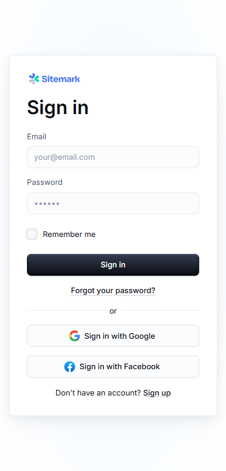
    
- TELA INICIAL
    
    
    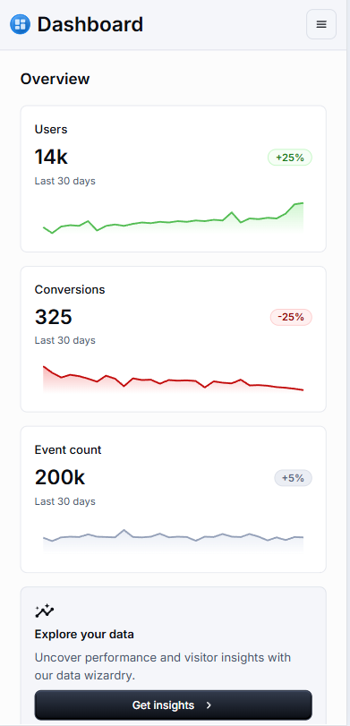
    
    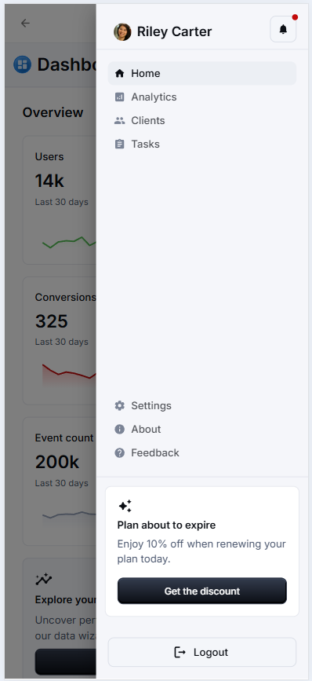
    
    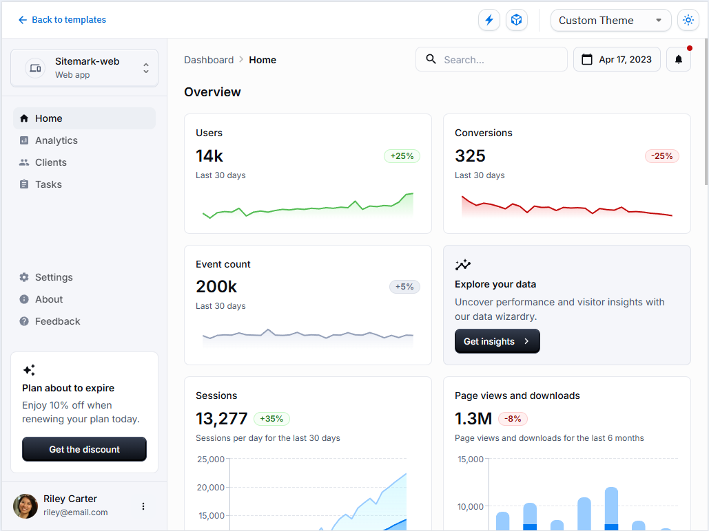
    
- CADASTRO ALUNOS / TURMAS / USUARIOS
    
    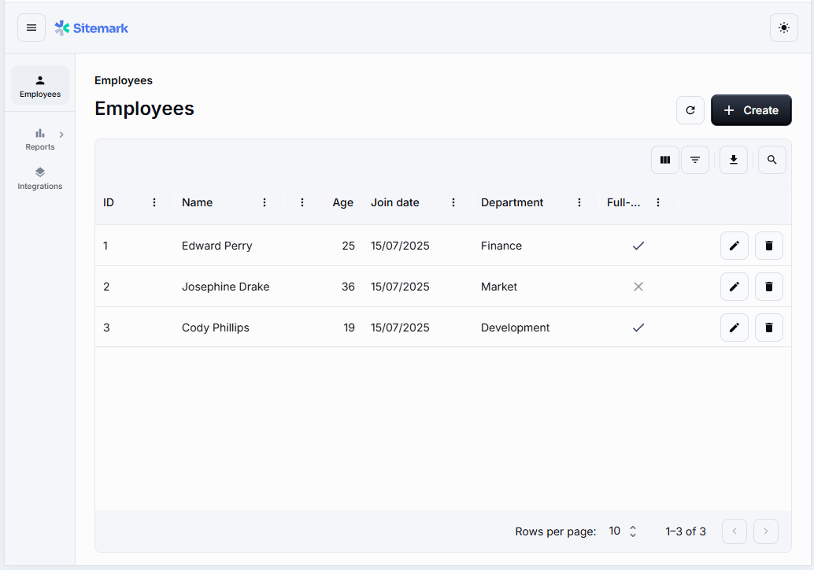
    
    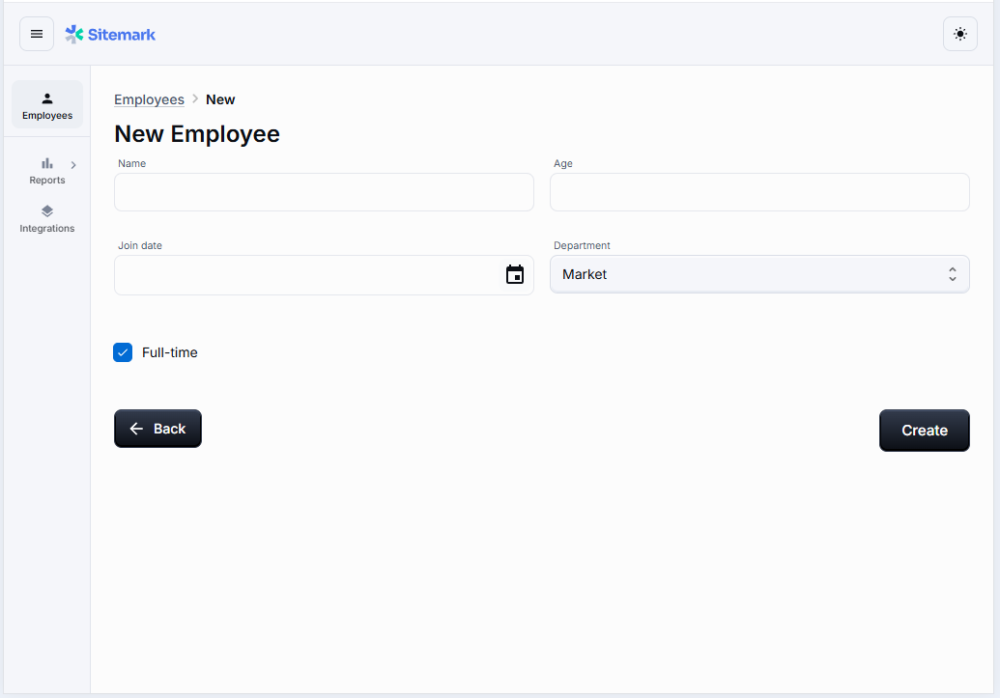
    
- CADASTRO DE AULAS NA SEMANA
    
    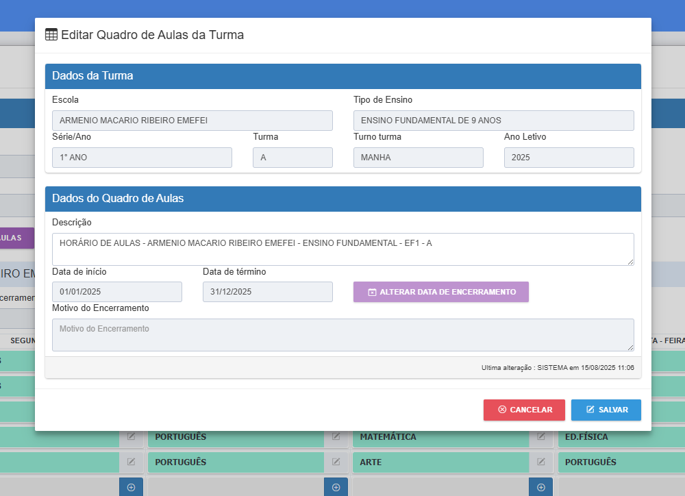
    
    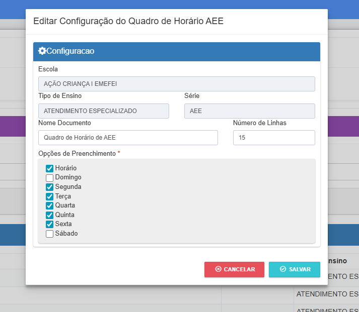
    
    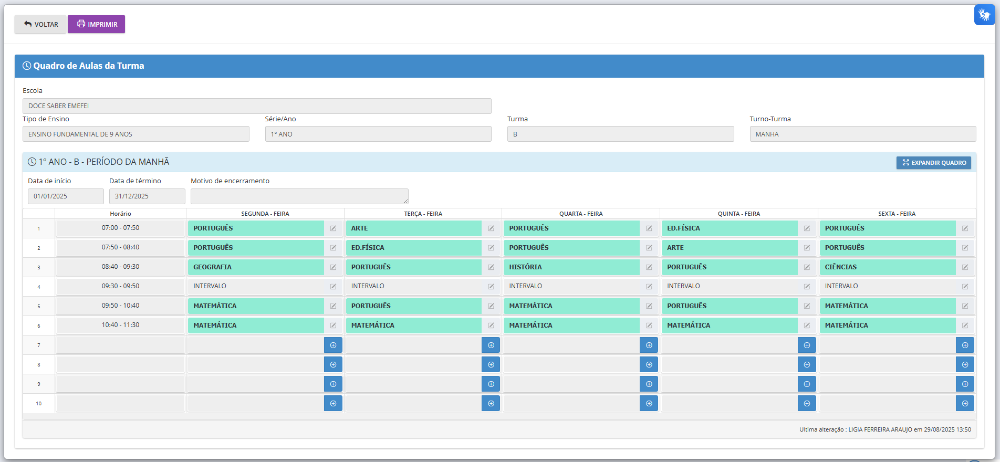
    
- LANÇAMENTO DE AULAS
    
    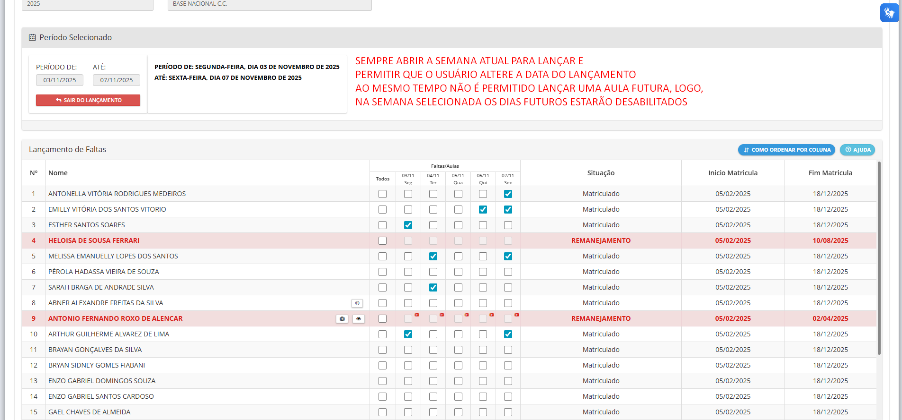
    
- LANÇAMENTO DE MENSALIDADES
    
    nada por aqui ainda
    

### REGRAS DE NEGÓCIO

- SISTEMA
    - É FOCADO PARA POUCOS USUÁRIO, ONDE TODOS OS USUÁRIOS ACESSARÃO OS MESMOS DADOS
    - PODE-SE CADASTRAR MAIS DE UMA TURMA, PORÉM CASO SÓ EXISTA UMA CADASTRADA ESTA SERÁ SELECIONADA AUTOMATICAMENTE PARA CONSULTA OU LANÇAMENTO
    - PARA REALIZAR QUALQUER AÇÃO NO SISTEMA O USUÁRIO PRECISA ESTAR LOGADO
    - OS RELATÓRIOS SERÃO EMITIDOS A PARTIR DE UM PERÍODO ESPECIFICADO NOS FILTROS
    - O DASHBOARD EXIBE UM RESUMO DO ANO ATUAL
    - O MENU DE OPÇÕES SERÁ EXIBIDO EM TODAS AS TELAS
- USUARIOS
    - NÃO É POSSÍVEL UM USUÁRIO SE AUTO CADASTRAR
    - É POSSÍVEL TROCAR A SENHA DE ACESSO DE DENTRO DO SISTEMA
- QUADRO DE AULAS
    - POSSUI PERÍODO DE VIGÊNCIA DAQUELE QUADRO E QUAIS DIAS ESTÃO DISPONÍVEIS
    - É POSSÍVEL TER MAIS DE UM QUADRO, CRIANDO UMA ORDEM CRONOLÓGICA
- TURMAS
    - POSSUI A NOMENCLATURA DA TURMA
    - POSSUI VALOR DAS MENSALIDADES? (NÃO DECIDI AINDA)
    - NÃO POSSUI PERÍODO LETIVO
- ALUNOS
    - ALUNOS CADASTRADOS DEVERÃO SER VINCULADOS A UMA TURMA (MATRICULA) 1 → N
- MATRÍCULA
    - DEVE POSSUIR O PERÍODO QUE O ALUNO ESTEVE MATRICULADO NA TURMA
- LANÇAMENTOS DE AULA
    - OS DIAS HABILITADOS PARA LANÇAMENTO DEVERÃO SER INFORMADOS NO QUADRO DE AULAS DA SEMANA
    - AO LANÇAR AULAS DEVE-SE MARCAR NO QUADRO OS ALUNOS PRESENTES NO DIA
    - O LANÇAMENTO É FEITO NO PERÍODO SELECIONADO, PORÉM AO ENTRAR NO LANÇAMENTO EXIBE-SE A SEMANA ATUAL
    - CASO O DIA DE AULA SEJA POSTERIOR A DATA SELECIONADA NÃO É POSSÍVEL MARCAR PRESENÇAS NO DIA
    - CASO O DIA SELECIONADO NÃO FAÇA PARTE DO PERÍODO DE MATRÍCULA DO ALUNO NA TURMA O DIA NÃO SERÁ HABILITADO PARA MARCAR A PRESENÇA DO ALUNO
- LANÇAMENTOS DE MENSALIDADE
    - INFORMA-SE A DATA DE PAGAMENTO, FORMA DE PAGAMENTO
    - SÓ SERÁ LANÇADO CASO O ALUNO FAÇA PARTE DA TURMA NO PERÍODO

### FLUXO DE TELAS

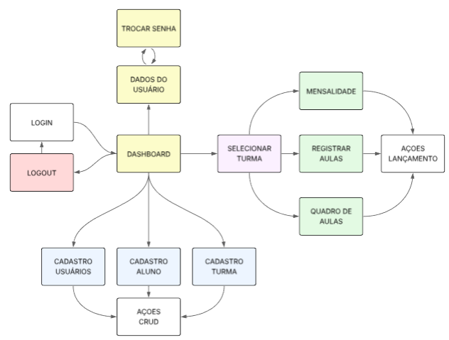

### APP

<aside>
📂

**ESTRUTURA DE PASTAS**

controle-presenca/
├── public/                 # Arquivos públicos (index.html, imagens estáticas)
├── src/                    # Código-fonte principal
│   ├── assets/             # Imagens, fontes, ícones, etc.
│   ├── components/         # Componentes reutilizáveis
│   ├── pages/              # Páginas da aplicação (ex: Home, About)
│   ├── layouts/            # Layouts compartilhados entre páginas
│   ├── hooks/              # Custom hooks
│   ├── context/            # React Contexts (ex: AuthContext)
│   ├── services/           # APIs e serviços externos
│   ├── utils/              # Funções utilitárias
│   ├── styles/             # Estilos globais e temas
├── .env                    # Variáveis de ambiente
├── .gitignore              # Arquivos ignorados pelo Git
├── package.json            # Dependências e scripts
├── [README.md](http://readme.md/)               # Documentação do projeto

</aside>

<aside>

# Levantamento das Tabelas

## 1. **users**

 `id
  name
  email
  email_verified_at
  password
  remember_token
  created_at
  updated_at`

## 2. **turmas**

  `id
  nome
  descricao
  created_by    -> FK para users.id
  updated_by    -> FK para users.id
  created_at
  updated_at`

## 3. **alunos**

  `id
  nome
  data_nascimento
  cpf
  rg
  telefone
  email
  endereco
  sexo
  data_matricula
  nome_pai
  telefone_pai
  nome_mae
  telefone_mae
  observacoes
  status          -> ativo/inativo
  created_by      -> FK para users.id
  updated_by      -> FK para users.id
  created_at
  updated_at`

## 4. **graduacoes**

 `id  
  aluno_id        -> FK para alunos.id
  faixa            -> faixa concedida (ex: branca, azul)
  grau            -> grau recebido dentro da faixa (ex: 1, 2, 3, 4)
  data_graduacao
  observacoes
  created_by      -> FK para users.id
  updated_by      -> FK para users.id
  created_at
  updated_at`

## 5. **alunoxturma**

  `id
  aluno_id        -> FK para alunos.id
  turma_id        -> FK para turmas.id
  created_at
  updated_at`

## 6. **quadro_aulas_turma**

  `id
  turma_id        -> FK para turmas.id
  domingo         -> boolean
  segunda         -> boolean
  terca           -> boolean
  quarta          -> boolean
  quinta          -> boolean
  sexta           -> boolean
  sabado          -> boolean
  created_by      -> FK para users.id
  updated_by      -> FK para users.id
  created_at
  updated_at`

## 7. **aulas**

  `id
  turma_id        -> FK para turmas.id
  data_aula
  created_by      -> FK para users.id
  updated_by      -> FK para users.id
  created_at
  updated_at`

## 8. **presencas**

  `id
  aula_id         -> FK para aulas.id
  aluno_id        -> FK para alunos.id
  presente        -> boolean
  created_by      -> FK para users.id
  updated_by      -> FK para users.id
  created_at
  updated_at`

</aside>