# Telas — Fase 1 (presença)

Wireframes das telas da Fase 1. São a referência para implementar o app: **nenhuma tela é implementada sem wireframe aprovado e registrado aqui** (veja [regras de desenvolvimento](../desenvolvimento.md#10-interface)).

- Fonte editável: [`wireframes-fase1.html`](wireframes-fase1.html) (abra no navegador; `?tela=4` mostra uma tela só): conteúdo e regras de cada tela (v1 e v1.1).
- **Linguagem visual: [`wireframes-v2.html`](wireframes-v2.html)** (v2): cores, tipografia, botões, menu lateral no desktop e requisitos de implementação. Imagem: [`img/v2.png`](img/v2.png).
- **Relatórios: [`wireframes-relatorios.html`](wireframes-relatorios.html)** (v3): resultado de cada relatório da tela 7 (7a–7d), desktop (D5, D6) e a página impressa (P1). Imagem: [`img/relatorios.png`](img/relatorios.png).
- **Senha do professor: [`wireframes-senha-professor.html`](wireframes-senha-professor.html)** (v4, proposta): o superadmin abre a academia (13a), redefine a senha de um professor (13b, 13c, D7a–D7c). Imagem: [`img/senha-professor.png`](img/senha-professor.png).
- **Aparência e componentes implementados: [`componentes.md`](componentes.md)**: cores, fonte, ícones, formas, layout e as características de cada componente visual do app.
- Imagens: [`img/`](img/), geradas com `bash docs/telas/gerar-imagens.sh` (Git Bash; usa o Edge ou o navegador em `CHROME_EXECUTABLE`).
- Mensalidades (Fase 2) terão wireframes próprios quando a fase começar.

## Aprovação

| Versão | Data | Status | Observações |
|---|---|---|---|
| 1 | 12/11/2026 | **Aprovado** pelo responsável do projeto | Telas 1 a 14 (celular), 2b e 4b, e D1 a D4 (desktop). Inclui logotipo e ícone da academia, reposição fixa no quadro e lista do lançamento por frequência |
| 1.1 | 12/11/2026 | **Aprovado** pelo responsável do projeto | Telas 8b e 8c: importar alunos colando a lista copiada da planilha (sem escolher arquivo), com relatório de códigos repetidos ou já cadastrados antes de gravar |
| 3 | 13/11/2026 | **Aprovado** pelo responsável do projeto | Relatórios ([`wireframes-relatorios.html`](wireframes-relatorios.html)): tela 7 detalhada com atalhos de período, resultados semanal, mensal, anual e por aluno no celular (7a–7d) e no desktop (D5, D6), e a página impressa (P1) pelo navegador. Calculados no aparelho a partir das presenças |
| 2 | 13/11/2026 | **Aprovado** pelo responsável do projeto | Nova linguagem visual para todas as telas (revisão com as skills frontend-design e high-end-visual-design, e conferida com a web-design-guidelines): menu lateral fixo no desktop (D1 a D3), cor de destaque em todo botão de ação (principal azul, secundário azul-claro, voltar em círculo, destrutivo vermelho-claro), fonte Lexend e a faixa do aluno como único destaque. Conteúdo e regras das telas seguem a v1 |
| 4 | 13/11/2026 | Aguardando aprovação | Senha do professor ([`wireframes-senha-professor.html`](wireframes-senha-professor.html)): na tela 13, abrir a academia mostra os professores (13a) com o botão Redefinir senha; painel com a nova senha e Gerar senha (13b); confirmação com Copiar, mostrada uma vez (13c); desktop: academia aberta (D7a), nova senha (D7b) e confirmação (D7c) |

## Decisões de interface aprovadas

- **Visual da v2 vale para todas as telas.** As telas da v1 continuam definindo conteúdo e regras; cores, botões, tipografia e o menu lateral do desktop seguem [`wireframes-v2.html`](wireframes-v2.html), inclusive os requisitos de implementação no fim do arquivo (área de toque de 48 px, contraste, foco visível, movimento reduzido, rotas com endereço no desktop).
- **Todo botão de ação tem cor de destaque:** principal em pílula azul com ícone no círculo; secundário azul-claro; voltar em círculo azul-claro; ação que apaga ou encerra em vermelho-claro.

- **Celular primeiro.** Menu escondido (ícone ☰); a partir de ~1000 px de largura, menu lateral fixo (versão desktop).
- **Lançamento mostra um dia por vez no celular** e a **grade da semana no desktop** (parecida com a planilha atual). Dia futuro e aluno fora do período da matrícula ficam bloqueados.
- **Lista do lançamento por frequência:** aparecem só os alunos **frequentes** (padrão: presentes em ao menos 30% das últimas 8 aulas), ordenados pela frequência. Os pouco frequentes ficam recolhidos e na **busca**; ao serem marcados, voltam para a lista. Matrícula nova (menos de 8 aulas) sempre aparece. Parâmetros configuráveis por turma.
- **Alunos sumidos:** o início avisa quem não vem há mais de 4 semanas (configurável), com atalho para **encerrar a matrícula** (sugere a data da última presença).
- **Reposição fixa no quadro de aulas:** cada dia da semana é *sem aula*, *regular* ou *reposição*. O dia de reposição aparece sozinho no lançamento. Reposição em outro dia continua pelo botão **Reposição avulsa**.
- **Logotipo:** o login mostra o logotipo da TghServices (a academia ainda não é conhecida); depois do login aparece o **logotipo da academia**, também nos relatórios impressos. Sem logotipo, mostra o nome.
- **Ícone do app instalado = ícone da academia:** o convite para instalar só aparece **depois do login**, quando o app já sabe a academia e informa ao celular o nome curto e o ícone dela. No iPhone, uma tela explica o passo a passo. Endereço único para todos (`controlepresenca.tghservices.com.br`).
- **Telas por permissão:** Usuários só para `professor`; Academias só para `superadmin`.

## Celular

### 1. Entrar
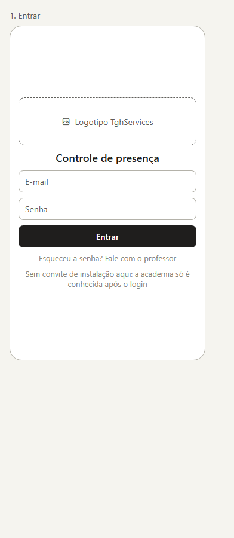

- **Objetivo:** login por e-mail e senha.
- **Quem acessa:** todos.
- **Regras:** primeiro login exige internet; sem convite de instalação (academia ainda desconhecida); esqueceu a senha → fala com o professor (não há autocadastro nem recuperação automática na Fase 1).

### 2. Início
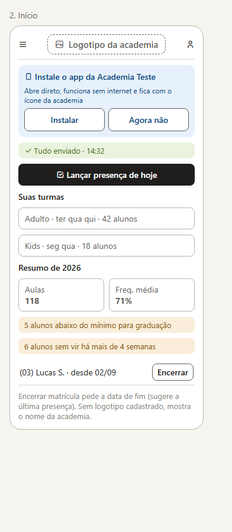

- **Objetivo:** ponto de partida e resumo do ano.
- **Quem acessa:** professor e assistente.
- **Elementos:** logotipo da academia; convite para instalar o app (some se já instalado ou se dispensado); status de envio; atalho "Lançar presença de hoje"; turmas do usuário; resumo do ano (aulas, frequência média); avisos de alunos abaixo do mínimo para graduação e de **alunos sumidos**, com botão Encerrar.

### 2b. Instalar no iPhone
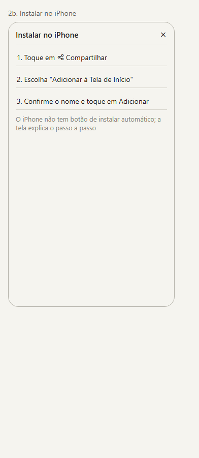

- **Objetivo:** explicar a instalação no iPhone, que não tem botão de instalar automático.
- **Abre a partir de:** botão Instalar do início, quando o aparelho é iPhone.

### 3. Escolher turma
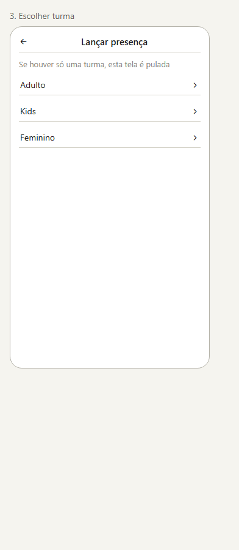

- **Objetivo:** escolher a turma do lançamento.
- **Regras:** se o usuário tem acesso a uma turma só, a tela é pulada.

### 4. Lançar presença
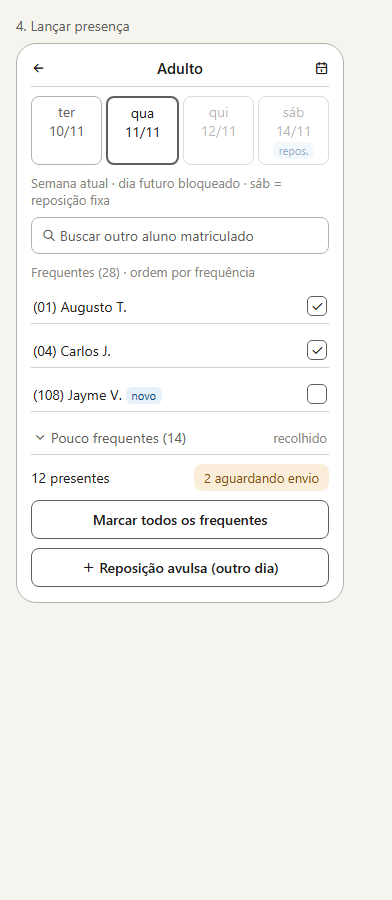

- **Objetivo:** marcar quem veio, rápido, durante a aula. **Tela principal do sistema.**
- **Quem acessa:** professor e assistente, nas turmas a que têm acesso.
- **Elementos:** dias da semana atual (dias regulares e de reposição do quadro; dia futuro bloqueado); busca de outro aluno matriculado; lista de **frequentes** ordenada por frequência (aluno novo com etiqueta); seção recolhida de **pouco frequentes**; total de presentes; status de envio; "Marcar todos os frequentes"; "Reposição avulsa".
- **Regras:** só alunos com matrícula válida na data; aula regular só em dia regular do quadro vigente; funciona **offline** (grava local, envia quando houver sinal) e mostra "N aguardando envio".

### 4b. Busca de aluno pouco frequente
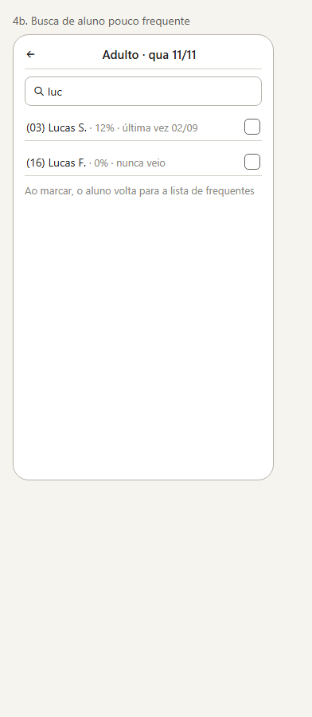

- **Objetivo:** marcar um aluno que não está na lista de frequentes.
- **Elementos:** resultado com frequência e data da última presença.
- **Regras:** ao marcar, o aluno volta para os frequentes.

### 5. Reposição avulsa
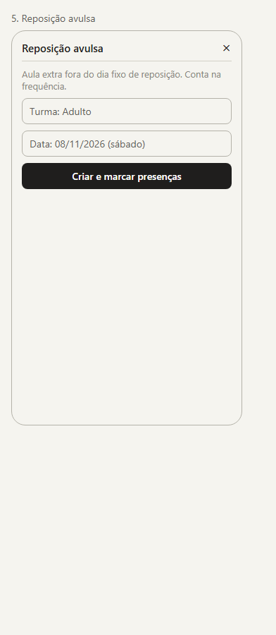

- **Objetivo:** criar uma aula extra fora do dia fixo de reposição e marcar as presenças.
- **Regras:** qualquer dia não futuro; conta na frequência como reposição (soma presença, não soma aula).

### 6. Frequência do semestre
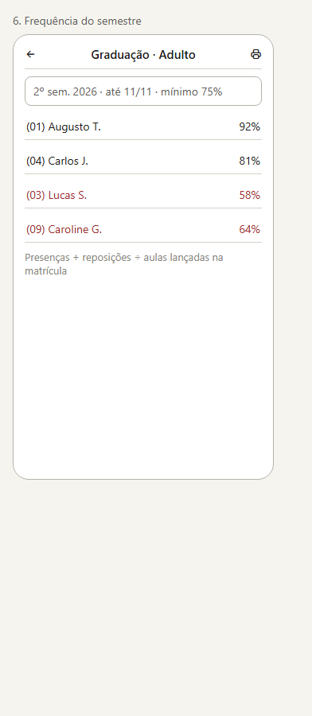

- **Objetivo:** consultar quem atinge a frequência mínima para graduação.
- **Regras:** presenças + reposições ÷ aulas regulares lançadas dentro da matrícula, no semestre (jan–jun, jul–dez), até a data; limite de 100%; abaixo do mínimo da turma em destaque.

### 7. Relatórios
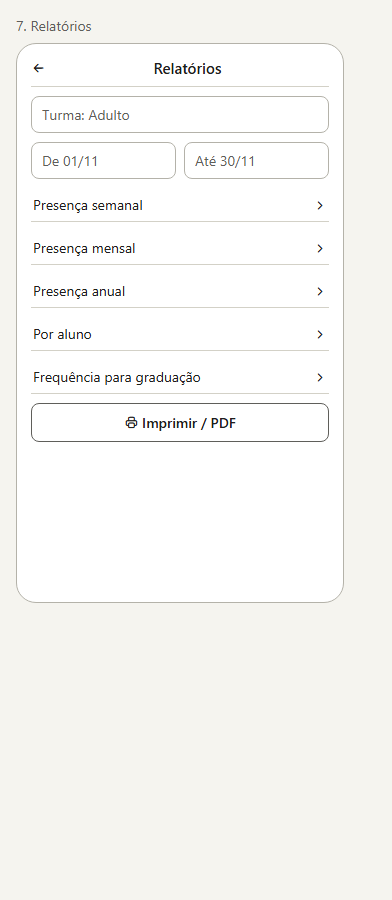

- **Objetivo:** escolher relatório e período: semanal, mensal, anual, por aluno, frequência para graduação.
- **Regras:** todos calculados a partir das presenças (nenhum total gravado); impressão/PDF com cabeçalho do tenant e da turma.
- **Resultados e impressão (v3):** [`wireframes-relatorios.html`](wireframes-relatorios.html). Falta = aula lançada sem presença, dentro da matrícula; frequência pela regra da graduação. No celular cada relatório abre numa tela própria; no desktop aparece abaixo dos filtros. Imprimir / PDF abre a página numa aba nova.

### 8. Alunos
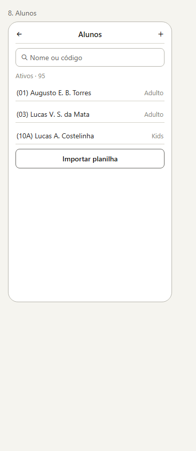

- **Objetivo:** listar, buscar, cadastrar e importar alunos.
- **Regras:** busca por nome ou código; importação da planilha mostra códigos duplicados antes de gravar. **Online.**

### 8b. Importar alunos · colar a lista
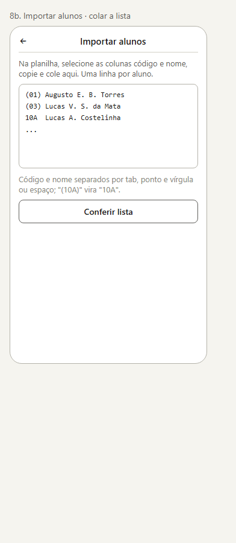

- **Objetivo:** trazer a lista de alunos da planilha (código + nome) sem digitar um por um.
- **Abre a partir de:** botão "Importar planilha" da tela 8.
- **Regras:** o usuário copia as colunas código e nome da planilha e cola; uma linha por aluno; código e nome separados por tab, ponto e vírgula ou espaço; "(10A)" vira "10A". Não precisa escolher arquivo. **Online.**

### 8c. Importar alunos · relatório
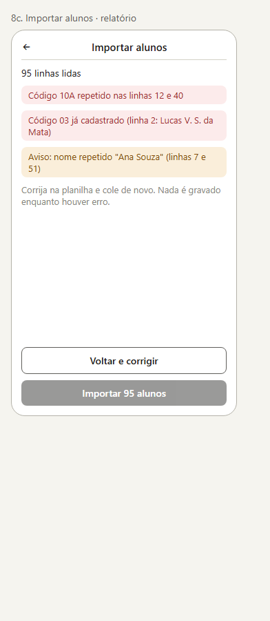

- **Objetivo:** mostrar os problemas antes de gravar qualquer coisa.
- **Regras:** linha sem código ou sem nome, código repetido na lista e código já cadastrado na academia **impedem** a importação; nome repetido é só aviso (irmãos e homônimos existem). Nada é gravado enquanto houver erro; o botão "Importar N alunos" só fica disponível sem erros.

### 9. Aluno
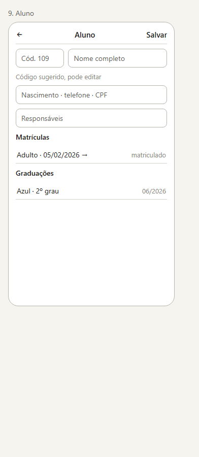

- **Objetivo:** cadastro do aluno, matrículas e graduações.
- **Regras:** código sugerido (próximo livre) e editável, único na academia; dados sensíveis só online.

### 10. Turma
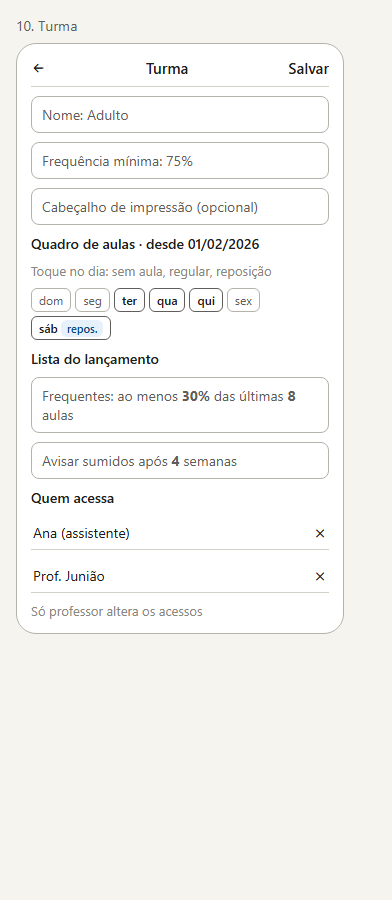

- **Objetivo:** configurar a turma.
- **Elementos:** nome; frequência mínima (%); cabeçalho de impressão; **quadro de aulas** (cada dia: sem aula, regular, reposição) com vigência; **lista do lançamento** (percentual e número de aulas); prazo de **alunos sumidos**; quem acessa a turma.
- **Regras:** só `professor` altera os acessos. **Online.**

### 11. Usuários
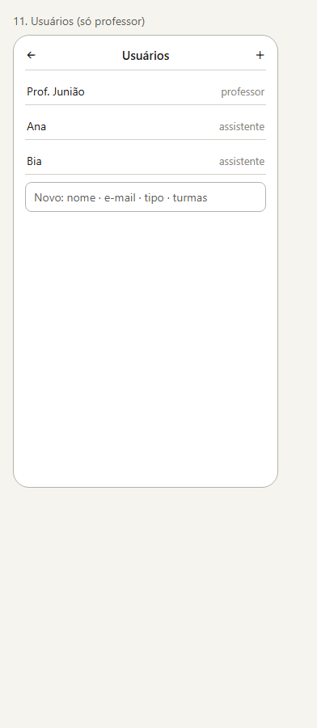

- **Objetivo:** cadastrar professores e assistentes e definir as turmas de cada um.
- **Quem acessa:** só `professor`.

### 12. Menu e meus dados
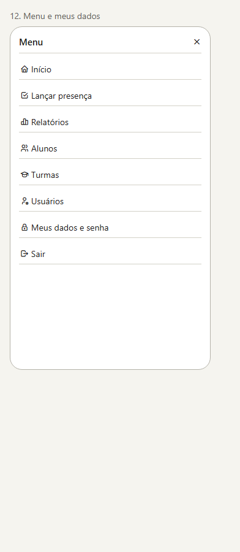

- **Objetivo:** navegação, troca de senha e saída.
- **Regras:** itens aparecem conforme a permissão; sair apaga os dados locais (avisa se houver lançamentos não enviados).

### 13. Administrador do sistema
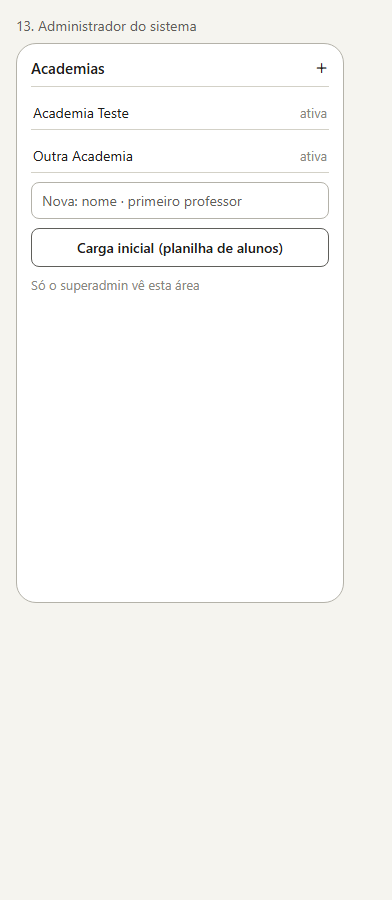

- **Objetivo:** cadastrar academias, o primeiro professor de cada uma e fazer a carga inicial de alunos.
- **Quem acessa:** só `superadmin`.

### 14. Dados da academia
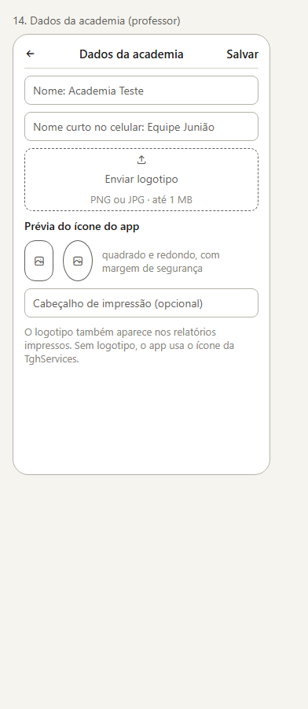

- **Objetivo:** nome, **nome curto** (aparece embaixo do ícone no celular), **logotipo** com **prévia do ícone** do app e cabeçalho de impressão.
- **Quem acessa:** `professor`.
- **Regras:** PNG ou JPG até 1 MB; o app gera os ícones 192 e 512 px com margem de segurança; sem logotipo, usa o ícone da TghServices.

## Desktop

### D1. Início
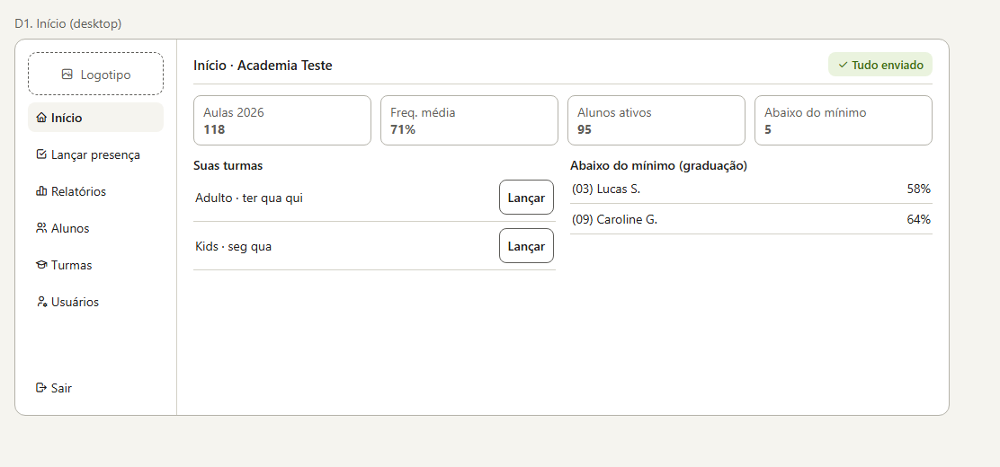

Menu lateral com logotipo, indicadores do ano, turmas com atalho para lançar e lista de alunos abaixo do mínimo.

### D2. Lançar presença
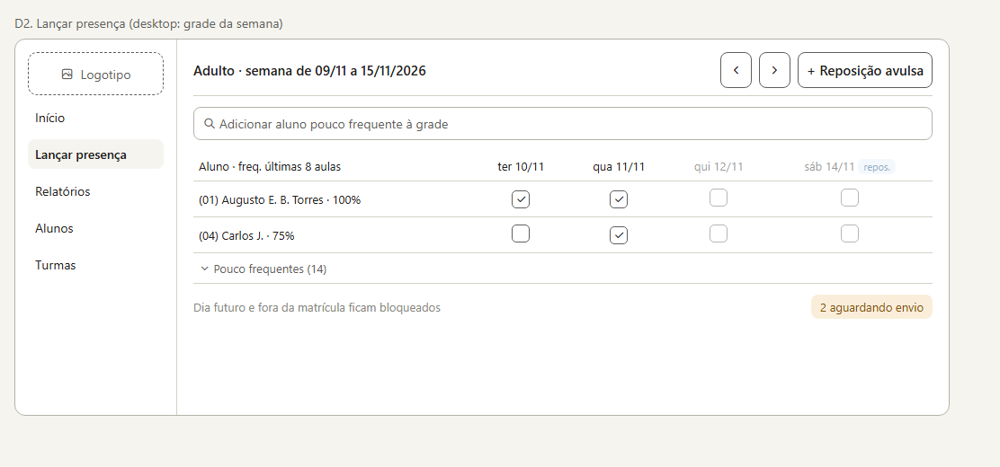

Grade da semana (dias regulares e de reposição), só com os frequentes e a frequência de cada um; campo para adicionar um aluno pouco frequente à grade; mesmas regras de bloqueio e de envio da tela 4.

### D3. Alunos
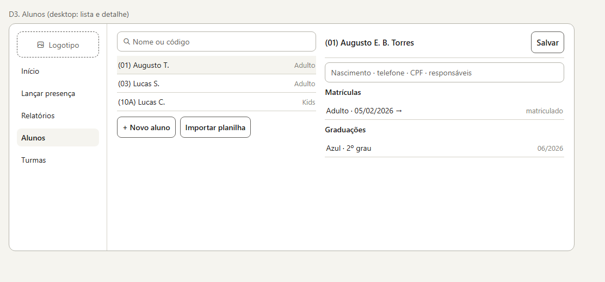

Lista e cadastro lado a lado.

### D4. Frequência do semestre
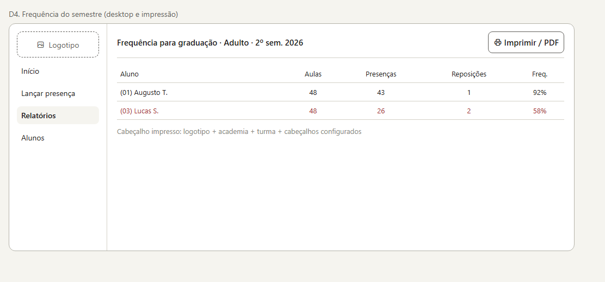

Tabela com aulas, presenças, reposições e frequência; impressão com logotipo e cabeçalhos configurados.
